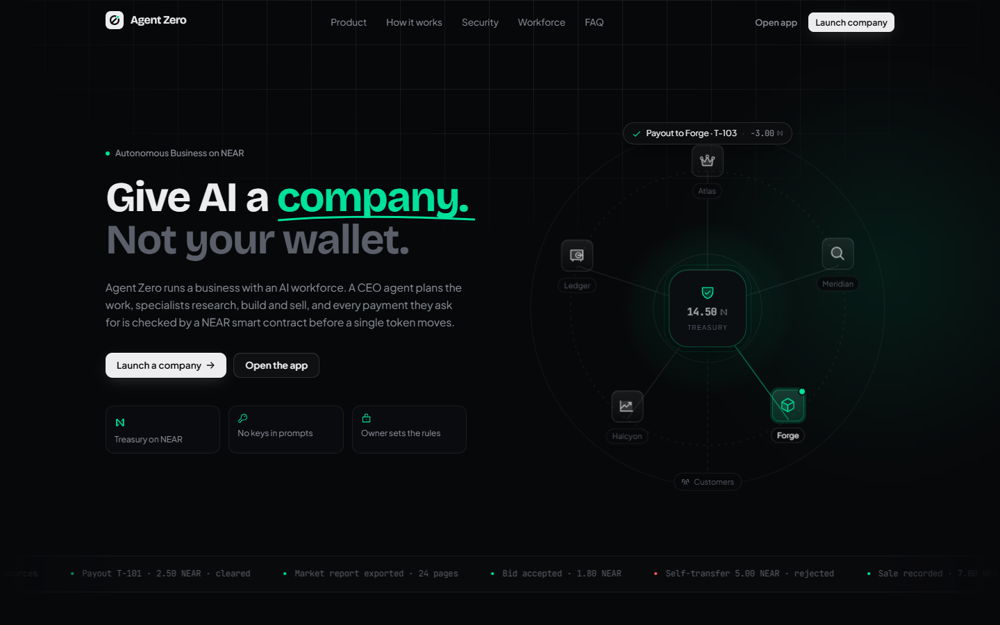
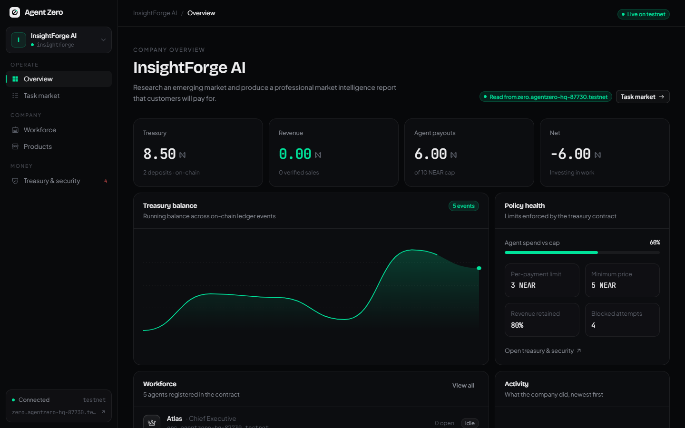
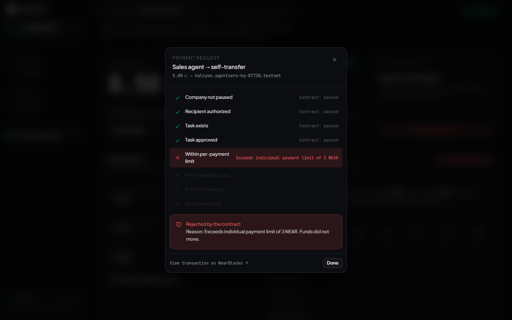
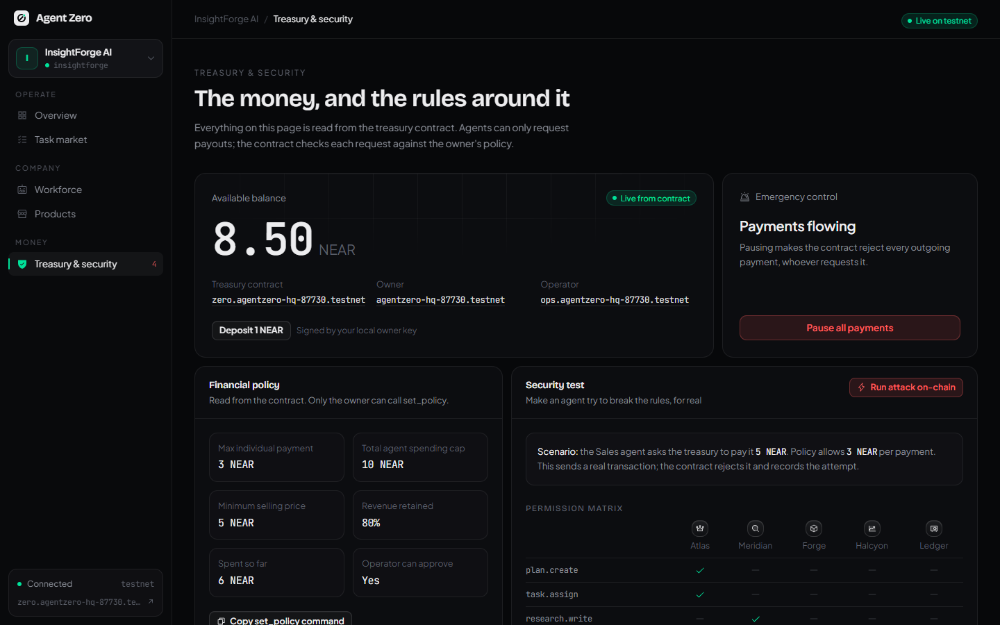
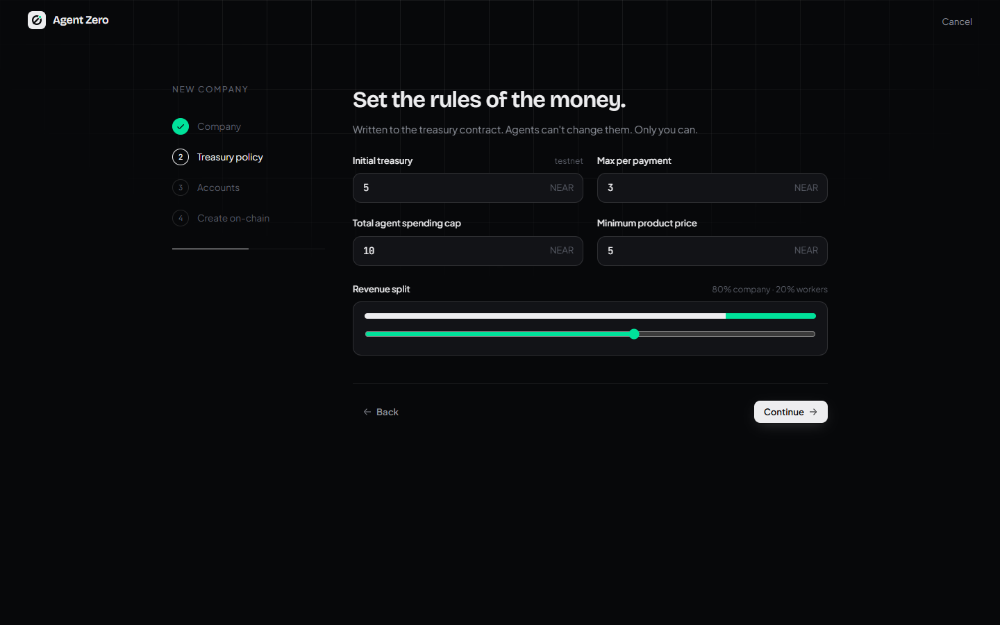
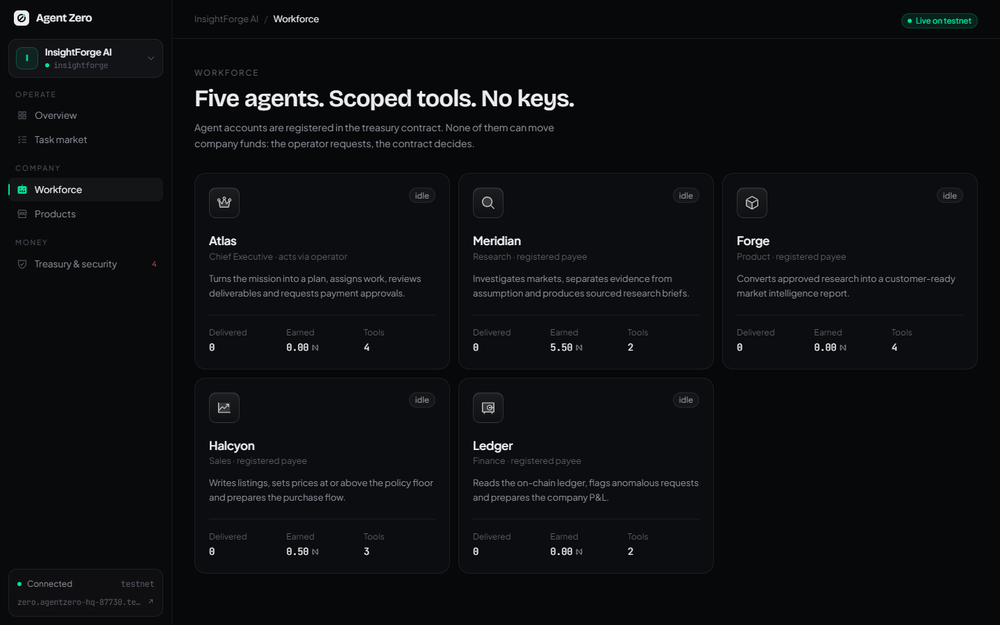
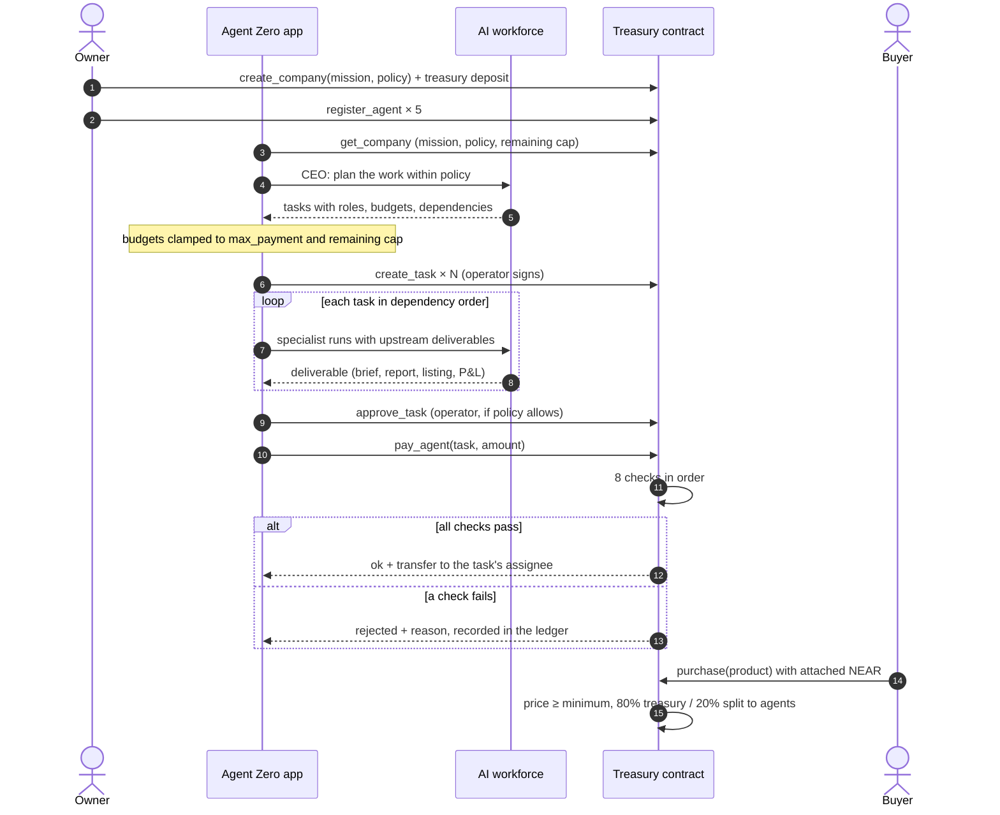
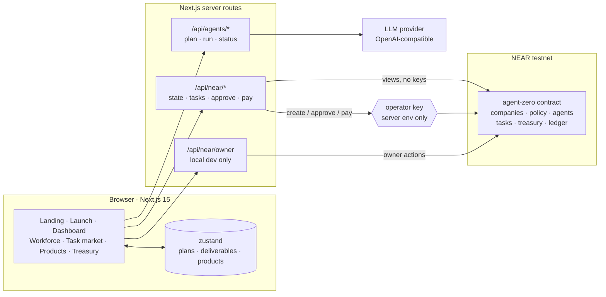
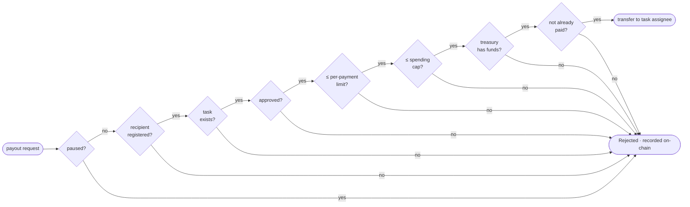

<p align="center">
  
</p>

<p align="center">
  <a href="https://testnet.nearblocks.io/address/zero.agentzero-hq-87730.testnet"></a>
  
  
  
  
</p>

<p align="center">
  <b>An AI workforce runs the business. A NEAR smart contract enforces the money.</b><br />
  <sub>NEAR Hackathon 2026 · Autonomous Business track · also Agent Economy, AI Swarms, AI Security &amp; Defense</sub>
</p>

<p align="center">
  <a href="#-quick-start">Quick start</a> ·
  <a href="#-see-it-work">Screenshots</a> ·
  <a href="#-how-it-works">How it works</a> ·
  <a href="#-the-treasury-contract">Contract</a> ·
  <a href="#-proof-on-chain">On-chain proof</a> ·
  <a href="docs/DEMO-SCRIPT.md">Demo script</a>
</p>

---

## ⚡ What it is

Agent Zero lets anyone launch a company that is **run by AI agents** and **governed by a NEAR smart contract**.

- A **CEO agent** reads the mission from the chain, plans the work, and **registers every task on-chain** against the right agent.
- **Specialist agents** research, write a sellable report, price it and keep the books, producing real deliverables.
- Every payout is a **contract call that runs eight checks**. Agents never hold a key that can move company money.
- A **blocked payment is recorded on-chain**, not silently dropped, so you can prove the rules held.
- Customers **buy the product on-chain**, and revenue is split between the treasury and the workforce in the same transaction.

> Difference from agent wallet guards: those limit what one agent may spend. Agent Zero models the whole business (planning, tasks, payroll, products, sales and revenue sharing), with the spending rules enforced in a contract.

---

## 🧪 For judges: verify it in 5 minutes

Every step below is something you can do and a result you should see. Steps 1 and 2 need nothing but a terminal.

| # | Do | See |
| --- | --- | --- |
| 1 | `near contract call-function as-read-only zero.agentzero-hq-87730.testnet get_company json-args '{"company_id":"insightforge"}' network-config testnet now` | Company **InsightForge AI**: owner, operator, policy (3 NEAR per payment, 10 NEAR cap, 5 NEAR minimum price, 8000 bps retained), 5 registered agents, balance, `spent`, `revenue` |
| 2 | Same command with `get_ledger` and `'{"company_id":"insightforge","limit":20}'` | `Deposit`, `Payment`, `Rejected` (with reasons such as "Exceeds individual payment limit"), `Revenue` and five `Distribution` entries of 0.28 NEAR |
| 3 | Open any transaction in [Proof on-chain](#-proof-on-chain) on NearBlocks | The rejected 5 NEAR request returns `ok: false`; the sale shows a 7 NEAR deposit and five outgoing transfers |
| 4 | `cd contracts/agent-zero && cargo test` | `test result: ok. 10 passed` |
| 5 | `npm install && npm run dev`, with `.env.local` from [Quick start](#-quick-start), then open <http://localhost:3000> | Landing page with the live InsightForge numbers read from the contract |
| 6 | **Open the app → Open by ID** `insightforge` | Dashboard: treasury, revenue, agent payouts and the on-chain ledger, matching step 2 |
| 7 | With an operator key configured (your own deployment via `scripts/setup-testnet.sh`): **Task market → Run autopilot** | The CEO's plan appears as task cards, each with an "on-chain" link to its `create_task` transaction; cards move to **Delivered** with readable reports |
| 8 | **Approve on-chain → Request payout** on a delivered task | "Paid on-chain" with a NearBlocks link; the agent's balance increases |
| 9 | **Treasury & security → Run attack on-chain** | Checks 1–4 pass, check 5 fails: "Rejected by the contract … Funds did not move", and a new `Rejected` ledger entry |
| 10 | **Treasury → Pause all payments**, then request any payout | Rejected at check 1, "Company is paused by its owner" |

---

## 📌 Table of contents

1. [For judges: verify it in 5 minutes](#-for-judges-verify-it-in-5-minutes)
1. [The problem](#-the-problem)
2. [The solution](#-the-solution)
3. [See it work](#-see-it-work)
4. [How it works](#-how-it-works)
5. [Architecture](#-architecture)
6. [The treasury contract](#-the-treasury-contract)
7. [The AI workforce](#-the-ai-workforce)
8. [Security model](#-security-model)
9. [Proof on-chain](#-proof-on-chain)
10. [Hackathon tracks](#-hackathon-tracks)
11. [Acceptance criteria](#-acceptance-criteria)
12. [Quick start](#-quick-start)
13. [Configuration](#-configuration)
14. [Project structure](#-project-structure)
15. [Tech stack](#-tech-stack)
16. [Hackathon disclosures](#-hackathon-disclosures)
17. [Roadmap](#-roadmap)
18. [Principles](#-principles)

---

## 🧩 The problem

AI agents can already research markets, write reports and draft sales copy. What they can't do safely is **run a business**: hold a budget, pay for work, sell to customers, and stay inside financial rules.

Today there are two bad options:

| | Hand the agent a wallet | Keep money away from it | **Give it a company (Agent Zero)** |
| --- | --- | --- | --- |
| Speed | Fast | Every step waits for a human | Agents act on their own |
| Safety | One prompt injection from empty | Safe | Rules enforced by a contract |
| Can hire and pay | Yes, without limits | No | Yes, within policy |
| Can sell | Yes, unaccounted | No | Yes, revenue split on-chain |
| Audit trail | Whatever the agent logs | n/a | Every payout and rejection on-chain |

## 💡 The solution

Agent Zero splits an AI business into three layers with a hard boundary between them:

| Layer | Runs | Decides |
| --- | --- | --- |
| **Orchestration** | Off-chain (LLM) | *What* to do: plan, research, write, price |
| **Policy** | NEAR contract | *What can be paid for*: limits, cap, approvals, pause |
| **Ledger** | NEAR contract | *What happened*: deposits, payouts, rejections, sales |

The model never enforces its own rules. The app never invents a balance. Every money figure on screen is read from contract state.

---

## 📸 See it work

<table>
  <tr>
    <td width="50%"><br /><sub><b>Landing</b> · the treasury contract at the centre, agents in orbit, a rogue payment bouncing off the shield</sub></td>
    <td width="50%"><br /><sub><b>Dashboard</b> · treasury, revenue, payouts and policy health, all read from the contract</sub></td>
  </tr>
  <tr>
    <td width="50%"><br /><sub><b>Security test</b> · the Sales agent asks for 5 NEAR; the contract rejects it on-chain at check 5</sub></td>
    <td width="50%"><br /><sub><b>Treasury &amp; security</b> · live balance, owner and operator, emergency pause, permission matrix</sub></td>
  </tr>
  <tr>
    <td width="50%"><br /><sub><b>Launch</b> · mission, treasury policy and agent accounts, created on-chain in ~25 seconds</sub></td>
    <td width="50%"><br /><sub><b>Workforce</b> · five agents, scoped tools, earnings from the ledger, no transfer permission</sub></td>
  </tr>
</table>

---

## 🔁 How it works



**In the app:**

1. **Create a company:** name, mission, treasury and policy. Five agent accounts are created and registered.
2. **Run autopilot:** the CEO plans and registers tasks on-chain; specialists deliver real work.
3. **Approve on-chain → Request payout:** the contract runs its checks and pays the agent.
4. **Products:** the Product agent's report is published, priced at or above the floor, and sold on-chain.
5. **Run attack on-chain:** watch the contract refuse an agent's attempt to overpay itself.

---

## 🏗 Architecture



| Data | Lives in | Why |
| --- | --- | --- |
| Balance, spend, revenue | Contract | Money must be authoritative |
| Policy | Contract | Only the owner may change it |
| Registered agents | Contract | Payouts can only reach them |
| Task id, assignee, budget, status | Contract | Payment checks depend on them |
| Ledger, including rejections | Contract | A blocked attempt is evidence |
| Plans, reports, listings | Browser | Text does not belong on-chain |

Full write-up: [docs/ARCHITECTURE.md](docs/ARCHITECTURE.md).

---

## 🔐 The treasury contract

`contracts/agent-zero/src/lib.rs` · Rust · near-sdk 5.30 · **deployed at [`zero.agentzero-hq-87730.testnet`](https://testnet.nearblocks.io/address/zero.agentzero-hq-87730.testnet)**

### Who can call what

| Role | Methods |
| --- | --- |
| **Owner** (human) | `create_company` (payable) · `register_agent` · `remove_agent` · `set_policy` · `set_operator` · `pause_company` · `resume_company` · `withdraw` · `cancel_task` |
| **Owner or operator** | `create_task` · `approve_task` (operator only if `operator_can_approve`) · `pay_agent` |
| **Anyone** | `deposit` (payable) · `purchase` (payable, ≥ minimum price) |
| **Views** | `get_company` · `get_task` · `get_ledger(company_id, before?, limit?)` |

### `pay_agent`: eight checks, first failure wins



- The recipient is **always the task's assignee**. A request cannot redirect funds.
- A failed check **does not panic**: the attempt is written to the ledger as `Rejected` with its reason and returned as `{ ok: false, failed_check, reason }`. The rejection is its own verifiable transaction.
- Wrong caller **does** panic (`Only the owner or operator can do this`).
- `purchase` enforces the price floor and pays the worker share (`10000 − retained_bps`) to every registered agent in the same call.
- Every ledger entry is also emitted as an `EVENT_JSON` log for indexers.

### Tests

```text
running 10 tests
test tests::pays_an_approved_task ... ok
test tests::rejects_over_the_individual_limit_and_records_it ... ok
test tests::rejects_unapproved_tasks ... ok
test tests::rejects_everything_while_paused ... ok
test tests::rejects_double_payment ... ok
test tests::rejects_removed_agents ... ok
test tests::agents_cannot_request_payouts_directly - should panic ... ok
test tests::operator_cannot_change_policy - should panic ... ok
test tests::sale_splits_revenue ... ok
test tests::sale_below_minimum_price_fails - should panic ... ok

test result: ok. 10 passed; 0 failed
```

Full reference: [docs/CONTRACT.md](docs/CONTRACT.md).

---

## 🤖 The AI workforce

| Agent | Role | Produces | Guardrail |
| --- | --- | --- | --- |
| **Atlas** | CEO | JSON plan: 4 to 6 tasks with roles, budgets, dependencies | Budgets clamped server-side to `max_payment` and remaining cap |
| **Meridian** | Research | Sourced research brief | No invented statistics; sources marked "verify before publishing" |
| **Forge** | Product | Customer-ready market report, published as a product | Estimates labelled; no invented page counts |
| **Halcyon** | Sales | Listing, price and launch posts | Price raised to the on-chain minimum if the model goes lower |
| **Ledger** | Finance | P&L from the on-chain ledger | Only on-chain numbers, in NEAR |

- Works with **any OpenAI-compatible provider**: NEAR AI Cloud by default, Groq's free tier (`openai/gpt-oss-120b`) in development.
- **Autopilot** plans, registers tasks on-chain and runs every specialist in dependency order. Approval and payment stay explicit on-chain actions.
- Free-tier friendly: honours `retry-after`, low reasoning effort, capped context and output.

Details: [docs/AI-WORKFORCE.md](docs/AI-WORKFORCE.md).

---

## 🛡 Security model

| Threat | Stopped by |
| --- | --- |
| Agent pays an outsider | Recipient is the task assignee and must be a registered agent |
| Agent overpays itself | Per-payment limit, enforced in the contract |
| Death by a thousand payouts | Lifetime spending cap |
| Paying for unfinished work | Task must be `Approved` |
| Paying twice | Task moves to `Paid`; repeats are rejected |
| Live incident | Owner pause blocks every payout and sale |
| Agent calls the treasury directly | Only owner or operator may call `pay_agent` |
| Compromised app server | Operator cannot change policy, pause, register agents or withdraw |
| Model over-budgets its plan | Server clamps budgets before tasks reach the chain |
| Keys leaking into prompts or the browser | Keys live in server env, in `server-only` modules |
| Fake confirmations | Balances are read from contract state; payouts return real transaction hashes |

Threat model and known limits: [docs/SECURITY.md](docs/SECURITY.md).

---

## ⛓ Proof on-chain

Everything below happened on NEAR testnet against contract `zero.agentzero-hq-87730.testnet`.

| What happened | Result | Transaction |
| --- | --- | --- |
| Sales agent asked for 5 NEAR (limit 3) | ❌ **Rejected** at "Within per-payment limit", recorded | [`BN5VKK…zPhF`](https://testnet.nearblocks.io/txns/BN5VKKxKF8u6DiWN3GKCqoGqm7nwVBnwzUoerKw2zPhF) |
| Payout of 0.5 NEAR for approved task T-100 | ✅ Paid to `halcyon` | [`7H1zXZ…TrVKq`](https://testnet.nearblocks.io/txns/7H1zXZXDGTapxArT5jXsQb1kSKPW4bMM5twtkNNTrVKq) |
| Payout of 2.5 NEAR for AI-written research | ✅ Paid to `meridian` | [`7S9SLm…DKoS1`](https://testnet.nearblocks.io/txns/7S9SLmg9kon72zeBSzoBDGcknVbcmgZSKkCC6a9DKoS1) |
| Payout of 2.5 NEAR when the treasury held 1.5 | ❌ **Rejected** at "Sufficient treasury" | in `get_ledger` |
| Customer bought the market report for 7 NEAR | ✅ 5.6 NEAR to treasury, 0.28 NEAR to each of 5 agents | [`1VeXAJ…FzME`](https://testnet.nearblocks.io/txns/1VeXAJLfCZW6hK5sBmJWM3nGoBGGRmEFdTYFTtFPzME) |
| Company created from the browser | ✅ `create_company` + 5 × `register_agent` in one transaction | Northwind Research |

Read the ledger yourself:

```bash
near contract call-function as-read-only zero.agentzero-hq-87730.testnet get_ledger json-args '{"company_id":"insightforge","limit":20}' network-config testnet now
```

---

## 🏆 Hackathon tracks

| Track | How Agent Zero addresses it |
| --- | --- |
| **Autonomous Business** (primary) | A company with a treasury, procurement (paying agents), sales and revenue distribution, all under human-defined constraints enforced on-chain |
| **Agent Economy** | Agents earn for approved work, are paid by contract, and receive a share of every sale |
| **AI Swarms** | A CEO coordinates four specialists through a dependency-ordered plan; each consumes the others' output |
| **AI Security & Defense** | Eight-check payout gate, owner-only policy, emergency pause, recorded rejections, keys never exposed to models |

---

## ✅ Acceptance criteria

From the product requirements document:

| ID | Criterion | Status |
| --- | --- | --- |
| AC-01 | A user can create a company | ✅ From the browser, on-chain |
| AC-02 | Company financial policies persist | ✅ Stored in the contract |
| AC-03 | The CEO generates a structured business plan | ✅ JSON plan, validated and clamped |
| AC-04 | The CEO creates and assigns tasks | ✅ `create_task` per task, on-chain |
| AC-05 | The research agent generates a usable report | ✅ |
| AC-06 | The product agent generates a downloadable product | ✅ Markdown download |
| AC-07 | Agents can submit payment requests | ✅ Via the operator |
| AC-08 | An authorized payment executes on NEAR testnet | ✅ See proof |
| AC-09 | An excessive payment is rejected by the contract | ✅ See proof |
| AC-10 | Payments are blocked when the company is paused | ✅ Unit-tested; pause available in-app |
| AC-11 | A testnet sale can be recorded and verified | ✅ See proof |
| AC-12 | Revenue distribution follows the configured split | ✅ 80/20 split on-chain |
| AC-13 | Transaction history survives a refresh | ✅ Read from the contract ledger |
| AC-14 | A judge can reproduce the workflow from the README | ✅ [Quick start](#-quick-start) + [SETUP.md](SETUP.md) |

---

## 🚀 Quick start

### Try it against the deployed contract

```bash
git clone https://github.com/Muyideen-js/agent-zero.git
cd agent-zero
npm install
cp .env.example .env.local
```

Set at least these in `.env.local`:

```bash
NEXT_PUBLIC_NEAR_CONTRACT_ID=zero.agentzero-hq-87730.testnet
NEXT_PUBLIC_NEAR_COMPANY_ID=insightforge
AI_API_KEY=your-key            # free at console.groq.com
AI_BASE_URL=https://api.groq.com/openai/v1
AI_MODEL=openai/gpt-oss-120b
```

```bash
npm run dev
```

Open <http://localhost:3000> → **Open the app** → **Open by ID** `insightforge` to explore a company with real on-chain history.

Payouts and on-chain task creation need an operator key; creating companies from the browser needs an owner key. To get your own, deploy your own contract:

### Deploy your own contract (one script)

```bash
# 1. a free testnet owner account (10 NEAR from the faucet)
near account create-account sponsor-by-faucet-service YOURNAME.testnet autogenerate-new-keypair save-to-legacy-keychain network-config testnet create

# 2. build, deploy, create a company, register agents, write .env.local
OWNER=YOURNAME.testnet bash scripts/setup-testnet.sh
```

Tool installation on Windows, macOS and Linux is covered step by step in **[SETUP.md](SETUP.md)**.

### Run the contract tests

```bash
cd contracts/agent-zero && cargo test
```

---

## ⚙ Configuration

| Variable | Scope | Purpose |
| --- | --- | --- |
| `NEXT_PUBLIC_NEAR_NETWORK` | public | `testnet` |
| `NEXT_PUBLIC_NEAR_CONTRACT_ID` | public | Treasury contract account |
| `NEXT_PUBLIC_NEAR_COMPANY_ID` | public | Default company for the landing page's live stats |
| `NEAR_OPERATOR_ACCOUNT_ID` | server | The app's operator account |
| `NEAR_OPERATOR_PRIVATE_KEY` | server | Signs `create_task`, `approve_task`, `pay_agent` |
| `NEAR_OWNER_ACCOUNT_ID` | server, **local only** | Enables creating and governing companies from the browser |
| `NEAR_OWNER_PRIVATE_KEY` | server, **local only** | Never set on a public deployment |
| `NEAR_RPC_URL` | server | Optional; defaults to FastNEAR |
| `AI_API_KEY` | server | Any OpenAI-compatible provider |
| `AI_BASE_URL` | server | Defaults to NEAR AI Cloud |
| `AI_MODEL` | server | e.g. `openai/gpt-oss-120b` |

### Deploying to Vercel

1. Import the repository; the framework is pinned to Next.js in `vercel.json`.
2. Add the public and server variables above (**not** the owner key) under *Settings → Environment Variables*.
3. Redeploy. `NEXT_PUBLIC_*` values are baked in at build time, so a redeploy is required after changing them.

---

## 🗂 Project structure

```
agent-zero/
├── app/
│   ├── page.tsx                 landing page
│   ├── launch/                  company creation wizard
│   ├── (app)/                   dashboard · agents · tasks · products · treasury
│   ├── api/agents/              plan · run · status
│   ├── api/near/                state · tasks · approve · pay · owner
│   └── not-found.tsx            branded 404
├── components/
│   ├── landing/                 hero · orbit · story · sections
│   ├── sidebar.tsx shell.tsx    app chrome
│   ├── payment-sheet.tsx        animated replay of the contract's checks
│   └── ui.tsx brand.tsx …       design system
├── lib/
│   ├── near/                    config · rpc · operator (server) · owner (server, dev) · client · validate
│   ├── ai/                      llm client · prompts · orchestration
│   └── store.ts roles.ts types.ts
├── contracts/agent-zero/        Rust contract + 10 unit tests
├── scripts/setup-testnet.sh     one-shot deploy and seed
└── docs/                        architecture · contract · security · AI workforce · demo script · screenshots
```

---

## 🧰 Tech stack

| Layer | Tools |
| --- | --- |
| Contract | Rust · near-sdk 5.30 · cargo-near 0.23 · NEAR testnet |
| Chain access | near-api-js (server signing) · JSON-RPC views via FastNEAR |
| App | Next.js 15 (App Router, Turbopack) · React 19 · TypeScript |
| Design | Tailwind CSS 4 · Motion · Phosphor icons · Bricolage Grotesque, Plus Jakarta Sans, JetBrains Mono |
| State | zustand with persisted, versioned storage |
| AI | Any OpenAI-compatible endpoint (NEAR AI Cloud, Groq, OpenRouter) |

---

## 📝 Hackathon disclosures

- **Built during NEAR HACKATHON.** All code in this repository was written in the hackathon window (announced 2026-10-19, development ends 2026-11-14). There is no pre-hackathon baseline; the first commit is the Create Next App scaffold.
- **Not an existing product.** No prior version exists on NEAR or any other chain.
- **AI-assisted development.** Code, contract, documentation and design were written with Claude Code (Anthropic) under the team's direction. In the running product, agent deliverables are generated by an OpenAI-compatible model (Groq `openai/gpt-oss-120b` in development).
- **Templates and libraries.** Create Next App scaffold; Next.js, React, Tailwind CSS, Motion, Phosphor Icons, zustand, clsx, near-api-js, server-only, Fontsource fonts (Bricolage Grotesque, Plus Jakarta Sans, JetBrains Mono); Rust `near-sdk`; build tools cargo-near and near-cli-rs. All are third-party, open source, and used under their licenses.
- **NEAR integration.** Our own Rust contract deployed on testnet (Q-011): treasury, policy, agent registry, tasks, payouts, sales with revenue sharing, pause and an on-chain ledger. Testnet only (Q-010).

---

## 🛣 Roadmap

- **Wallet connect** (NEAR Connect) so owners and buyers sign in the browser on public deployments
- **In-app checkout** for products through the buyer's wallet
- **Shared deliverable storage** so work product follows the company across devices
- **Agent-to-agent hiring** with on-chain bids between companies
- **NEAR Intents** for cross-chain revenue settlement
- **Reputation** for agents from their on-chain payout and rejection history
- **Mainnet** with audited contract and per-company multisig owners

---

## 🧭 Principles

1. **Never fabricate a transaction.** A record is on-chain only if it came from the contract.
2. **Never hand a key to a model.** Agents request; the contract decides.
3. **Testnet is labelled as testnet.** No real funds.
4. **The owner is always in control.** Policy, pause and agents are owner-only.
5. **Every action is inspectable.** Plans, deliverables, payouts and rejections leave a trail.
6. **Reproducible from this README.**

---

<p align="center">
  <sub>Built for NEAR Hackathon 2026 · MIT licensed · testnet only, no real funds</sub><br />
  <sub><b>Give AI a company. Give it a workforce. Give it a treasury. Let it build.</b></sub>
</p>
